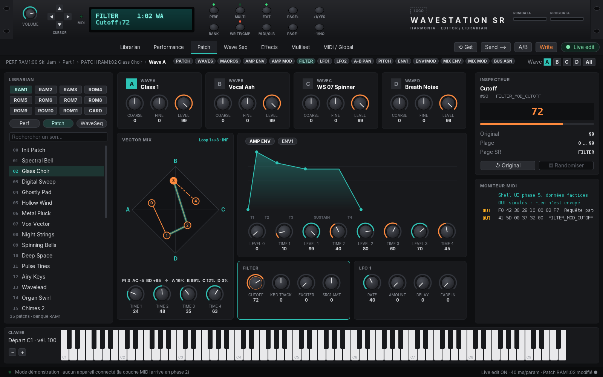

# Harmonia

[](https://github.com/obarry/Harmonia/actions/workflows/build.yml)

**MIDI editor / librarian for the KORG Wavestation SR**, written in Java.

Harmonia lets you control every setting of the Wavestation SR from your computer: load and save sounds, and edit performances, patches, wave sequences and effects **in real time** while playing a MIDI keyboard, in a modern interface inspired by the front panel of the device.



*Current state of the user interface. The sounds shown are still mock data until the Wavestation model exists (phase 3).*

## Project status

🚧 **Being rebuilt.** The user interface shell is in place and the MIDI layer can talk to the device; the Wavestation model (decoding of the sounds) comes next. The full roadmap is in [`docs/DESIGN_ROADMAP.md`](docs/DESIGN_ROADMAP.md) *(in French, English translation in progress)*.

| Phase | Content | Status |
|-------|---------|--------|
| P0 | Repository cleanup | ✅ |
| P1 | Maven build + GitHub Actions CI | ✅ |
| P2 | Reliable MIDI layer (SysEx, send queue, device detection) | ✅ |
| P3 | Wavestation model and codecs | 🔨 in progress (branch `phase3-model`) |
| P4 | Librarian (banks, `.syx` files) | ⏳ |
| P5 | UI shell, theme and front panel | ✅ |
| P7 | Performances, effects, multisets (before P6: the SR is performance-oriented) | ⏳ |
| P6 | Real-time patch editor | ⏳ |
| P8 | Wave sequences | ⏳ |
| P9 | Polish and 1.0 release | ⏳ |

## Requirements

- JDK 21 or later, Maven 3.6.3 or later
- A KORG Wavestation SR connected to the computer through a MIDI interface (IN and OUT)
- On the SR: a known basic channel, **MIDI › Param** set to `RECEIVE` or `RECV & TRANS`, **Memory Protect** off to write to RAM

## Build and run

```
mvn install
mvn -pl harmonia-ui exec:java
```

In Eclipse: *File › Import › Maven › Existing Maven Projects*, select the root folder (5 projects are imported), then run `com.harmonia.ui.HarmoniaApp` from the `harmonia-ui` module.

## Connecting the Wavestation SR

1. Connect the MIDI OUT of the SR to a MIDI IN of the computer, and a MIDI OUT of the computer to the MIDI IN of the SR.
2. On the SR, in **MIDI/GLOBAL › MIDI**, set **Param** to `RECV & TRANS` (needed for real-time editing) and note the basic channel.
3. In Harmonia, click **MIDI…**, choose the ports and click **Détecter le SR** (detect; the interface is in French for now): Harmonia asks the device to identify itself and sets the channel. Then click **Connecter**. The settings are remembered for the next start.
4. Optionally choose your master keyboard: what you play is forwarded to the SR on its channel (MIDI thru).

What works with the device today:

| Action | What happens |
|--------|--------------|
| Turn a knob | The parameter is sent to the SR edit buffer in real time (SysEx parameter change), for the part whose patch is open |
| Select a performance or a patch | Read from the SR and shown: the 8 parts and the effects of a performance, the values of a patch |
| Edit a part (Performance page) | Level, effect bus, transposition, detune, delay, key and velocity zones, voice and play modes: sent to the SR in real time (the part is selected first with CURRENT_PART) |
| First connection | Harmonia reads the whole memory of the SR in the background (about 4 min; RAM banks first), with a discreet progress text in the status bar. Each bank is saved on disk as soon as it is read |
| Next starts | The copy saved on disk (`~/.harmonia/library/`, one standard `.syx` file per bank) is loaded at once: browsing performances and patches no longer asks the SR anything |
| **Relire** / **Tout relire** (Librarian) | Reads the current bank, or every bank, again from the SR: useful if the SR was changed without Harmonia |
| Double-click a part | Opens the patch it plays, like EDIT on the device |
| **Get** | Reads the current patch again from the SR |
| **Send** | Sends the last patch read back to the SR edit buffer and waits for its acknowledgement |
| **Write** | Stores the SR edit buffer in the selected RAM location, after confirmation; the location is then read back to keep the local copy aligned |
| On-screen keyboard | Plays notes on the SR |

Without a device, Harmonia runs in demonstration mode and the MIDI monitor shows the messages that would be sent.

## Testing with the device

`harmonia-devicetest` is an interactive console tool that checks Harmonia against a real Wavestation SR. Harmonia sends and reads; you follow the instructions on the device and answer the questions (o / n / ?). Each session produces a Markdown report in `device-tests/<date>/`, with the dumps received and the photos of the device screen you choose to add.

```
mvn install
mvn -q -pl harmonia-devicetest exec:java                      # all tests
mvn -q -pl harmonia-devicetest exec:java -Dexec.args="--only T02,T04"
mvn -q -pl harmonia-devicetest exec:java -Dexec.args="--list"
```

In Eclipse: run `com.harmonia.devicetest.DeviceTestRunner` as a Java application (if accents are garbled in the console, add the VM argument `-Dstdout.encoding=UTF-8`).

| Test | Checks |
|------|--------|
| T01 | Device Inquiry: channel and system version |
| T02 | Selecting performances (Bank Select + Program Change) and the SysEx bank numbering |
| T03 | Parts of a performance (patch, bank, zones) against the EDIT PERF page |
| T04 | Patch values (structure, waves, vector mix points) against the PATCH, WAVES and MIX ENV pages |
| T05 | Whole bank dumps: checksums, decoding, byte-identical re-encoding |
| T06 | Real-time parameter change (filter cutoff) |
| T07 | Sending a patch to the edit buffer, Data Load Complete acknowledgement |
| T08 | Writing a patch to RAM (backed up and restored) |
| T09 | Messages sent by the SR from its front panel (program changes, parameters) |
| T10 | Master keyboard forwarded to the SR (MIDI thru) |
| T11 | Part and wave parameters after CURRENT_PART / CURRENT_WAVE, and their numbering |

## Using the interface

The front panel drawn at the top of the window is functional: its buttons work as on the device, and the LCD shows what the device would display.

| Action | Front panel button | Keyboard |
|--------|--------------------|----------|
| Change section | PERF, MULTI, MIDI/GLOBAL | Ctrl+1 … Ctrl+7 |
| Next / previous page | PAGE+ / PAGE− | Ctrl+PgDn / Ctrl+PgUp |
| Go down one level (performance → patch → wave sequence) | EDIT | Ctrl+E |
| Value +1 / −1 (or next / previous sound) | +1/YES, −1/NO | Arrow keys on the selected knob |
| Next bank | BANK | Ctrl+B |
| Write | WRITE/COMPARE | Ctrl+Shift+W |
| Next / previous wave | Cursor up / down | — |
| Next / previous parameter | Cursor left / right | Tab / Shift+Tab |

- **Knobs**: drag up or down (Shift for fine steps), mouse wheel, double-click for the default value, PgUp/PgDn for ±10.
- **Vector mix pad**: drag the 5 points of the mix envelope; double-click a point to centre it (equal mix); keys 0–4 select a point and the arrow keys move it. The mix percentages A/B/C/D are shown under the pad.
- **Envelopes**: drag a breakpoint vertically to change its level, horizontally to change the time of the segment that leads to it. The knobs follow, and vice versa.

**Logo**: Harmonia does not ship the Korg logo. To show a logo on the front panel, put your own image in `~/.harmonia/logo.png` (on Windows: `C:\Users\<you>\.harmonia\logo.png`).

## Modules

| Module | Role |
|--------|------|
| `harmonia-midi` | MIDI transport: ports, reception, SysEx |
| `harmonia-wavestation` | Wavestation SR profile: model, SysEx codecs, `.syx` files |
| `harmonia-app` | Application services: session, undo, library |
| `harmonia-ui` | Swing + FlatLaf user interface |
| `harmonia-devicetest` | Interactive console tests with a real Wavestation SR |

## Documentation

- [Analysis, design and roadmap](docs/DESIGN_ROADMAP.md) *(French)*
- The official Korg manuals (Player's Guide, Reference Guide, Performance Notes) are copyrighted: keep them locally in `docs/reference/`, a folder ignored by Git.

## Acknowledgements

- [Edisyn](https://github.com/eclab/edisyn) by Sean Luke, a valuable reference for the Wavestation SR SysEx implementation.

## License

[Apache License 2.0](LICENSE)

---

*Harmonia is not affiliated with KORG Inc. "KORG" and "Wavestation" are trademarks of their respective owners.*
