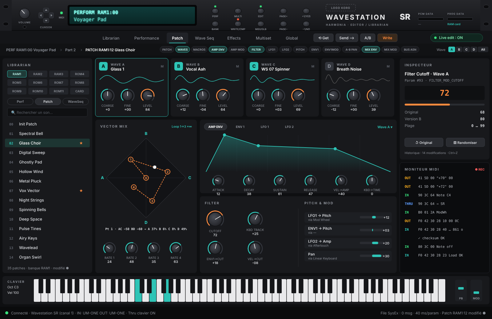
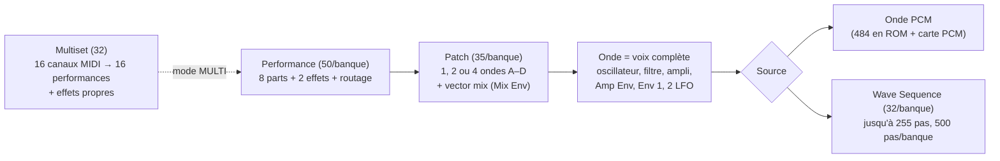
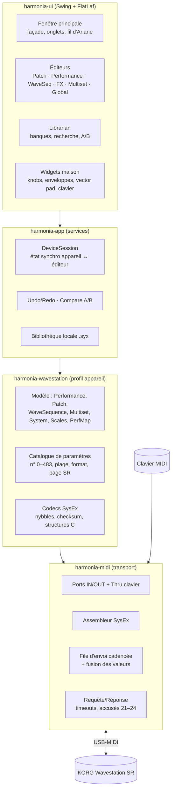
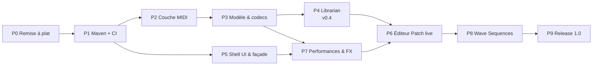

# Harmonia – Analyse, design et feuille de route

> Éditeur / librarian MIDI pour le **KORG Wavestation SR**, écrit en Java.
> Document de travail : il évolue au fil du projet.

*Maquette cible (non contractuelle). Le bandeau reprend la façade du WS/SR : molette VOLUME, croix de curseurs, LED MIDI, écran LCD 2 lignes, les 10 boutons (PERF, MULTI, EDIT, PAGE±, ±1, BANK, WRITE/COMPARE, MIDI/GLOBAL) et les fentes de cartes PCM / PROG. La barre de pages reprend les noms des pages de l'appareil. Source vectorielle : [`images/harmonia-mockup.svg`](images/harmonia-mockup.svg).*

---

## 1. Vision et objectifs

Harmonia doit rendre la création sonore sur le Wavestation SR aussi confortable que sur un synthé logiciel. L'appareil en rack n'offre qu'un écran de 2 lignes et une dizaine de boutons. Harmonia doit aussi **retrouver la logique de conception de l'appareil** : on doit pouvoir passer de l'un à l'autre sans se perdre.

| # | Objectif | Ce que ça veut dire concrètement |
|---|----------|----------------------------------|
| O1 | **Piloter tous les réglages** | Performances, patchs (1, 2 ou 4 ondes, vector mix, filtres, enveloppes, LFO, modulations, macros), wave sequences, effets, multisets, gammes, Performance Map, réglages MIDI/Global |
| O2 | **Charger et sauver tous les sons** | Lire et écrire les banques RAM/Carte ; import/export `.syx` ; sauvegarde complète ; bibliothèque locale |
| O3 | **Édition en temps réel** | Chaque bouton tourné à l'écran s'entend immédiatement pendant qu'on joue au clavier MIDI |
| O4 | **Interface moderne et fidèle** | Thème sombre « Korg », façade stylisée et fonctionnelle, ergonomie d'éditeur/DAW actuel (onglets, inspecteur, moniteur MIDI, undo, A/B) |
| O5 | **Code propre et didactique** | Architecture lisible, testée, construite avec Maven, publiée sur GitHub |

---

## 2. Analyse de l'existant

### 2.1 Ce qu'il y a dans le dépôt

| Élément | Contenu |
|---------|---------|
| Historique | 3 commits (janv. 2026) : *Create Project*, *Package structure refactoring*, *Implement Bank Management for Korg WSSR* |
| Build | Projet Eclipse pur (`.project`, `.classpath`), sortie dans `bin/`, compliance Java 23, aucune dépendance |
| Code | 6 classes, ~750 lignes |
| `com.harmonia.midi` | `MidiManager` (ouverture des ports), `MidiInputReceiver` (réception, relais vers l'UI), `SysexDumpCollector` (accumulation des dumps) |
| `com.harmonia.wavestation` | `WavestationSR` (construction / envoi SysEx), `PatchFileManager` (lecture / écriture `.syx`) |
| `com.harmonia.wavestation.gui` | `WaveStationEditor` : la **maquette Swing** actuelle (sélection des ports, journal MIDI, slider « cutoff » d'exemple, export/import de patchs et de banques) |
| État Git | Modifications non commitées dans 5 fichiers (surtout des commentaires), `bin/.gitignore` supprimé, `bin/com/` non suivi |

### 2.2 Points positifs

- Le découpage `midi` / `wavestation` / `gui` est une bonne base.
- La chaîne de bout en bout est en place : choix des ports, envoi de SysEx, réception, sauvegarde en fichier.
- La maquette valide que `javax.sound.midi` suffit (pas de dépendance native nécessaire sous Windows).

### 2.3 Problèmes identifiés (à corriger en priorité)

D'après l'**annexe 4 du Reference Guide** (format SysEx officiel, voir §5) et l'implémentation d'[Edisyn](https://github.com/eclab/edisyn), **la plupart des messages SysEx actuels ne correspondent pas au protocole du Wavestation**. L'appareil les ignore donc.

| # | Où | Problème | Correction |
|---|----|----------|------------|
| P1 | `WavestationSR.requestProgramDump` | Envoie `F0 42 30 3E 01 nn F7`. `3E` n'est pas l'ID du Wavestation et la banque est absente | `F0 42 3n 28 10 <banque> <num> F7` (patch) ou `… 19 …` (performance) |
| P2 | `requestBankDump` | `… 28 10 01 <banque>` : mélange la requête de patch et un code inventé | `… 28 1C <banque> F7` (patchs), `1D` (performances), `0C` (wave sequences) |
| P3 | `requestGlobalDump`, `sendParameterChange` | Codes `3E 00` / `3E 10` fictifs | Global : `0E`. Paramètres : fonction `41`/`42`/`43` + n° sur 2 × 7 bits + **valeur en texte ASCII** (§5.4) |
| P4 | `deviceId = 0x30` puis `0x30 \| deviceId` | Mélange entre ID et canal | Ne stocker que le canal de base `n` (0–15), l'octet vaut `0x30 + n` |
| P5 | `MidiInputReceiver` | Ré-encadre chaque message reçu par `F0…F7`. Sous Windows, Java peut découper un long SysEx en morceaux de continuation (statut `F7`) : le dump reconstruit est alors corrompu | Assembleur SysEx qui gère les continuations, vérification de longueur et de checksum |
| P6 | `exportPatch` / `exportBank` | `Thread.sleep(1000/4000)` **dans le thread Swing** : l'UI se fige. Le délai est aussi trop court : une banque de patchs fait 29 828 octets, soit environ **9,5 s** à 31 250 bauds | Requête asynchrone (`CompletableFuture`), délai calculé sur la taille attendue, barre de progression |
| P7 | `sendFullBank` / `sendFullPatch` | Aucun contrôle de débit ni d'accusé de réception | File d'envoi cadencée **et** attente du message *Data Load Complete* (`23`) ou *Data Load Error* (`24`) renvoyé par le SR |
| P8 | `isValidWavestationPatch` | Ne vérifie ni le modèle (`28`), ni la fonction, ni la taille, ni le checksum | Validation stricte : en-tête, code de fonction, longueur attendue, checksum |
| P9 | `MidiManager` | Les combos listent tous les périphériques, y compris ceux sans entrée ou sans sortie, et les synthés Java internes. Les `Info` sont comparés par référence | Filtrer par `getMaxTransmitters()`/`getMaxReceivers()`, mémoriser les ports, détection automatique par *Device Inquiry* |
| P10 | Encodage | Projet en `windows-1252`, accents déjà corrompus (`d�lai`) | Tout passer en **UTF-8** |
| P11 | Dépôt | `bin/` versionné ; pas de `README`, `LICENSE` ni `.gitignore` racine | Nettoyage (Phase 0) |
| P12 | GUI | Tout dans une seule classe (UI, logique, protocole) | Architecture en couches (§4) |
| P13 | Banques | Combo « RAM 1 / RAM 2 / ROM 1 / ROM 2 » | Le SR a **RAM 1–3, ROM 4–11 et CARD**, numérotées 0–11 en SysEx dans un ordre particulier (§5.2) |

> Le code de la maquette sert de **preuve de concept**. On garde l'idée et les noms de packages. Le protocole et l'UI seront réécrits proprement.

---

## 3. La logique du WS/SR, et comment Harmonia la reprend

Cette section résume les manuels officiels (Player's Guide, Reference Guide, Performance Notes) et en tire les principes de l'application.

### 3.1 Hiérarchie des sons

| Concept | Ce qu'il faut retenir pour l'application |
|---------|------------------------------------------|
| **Le SR joue des Performances**, jamais des patchs seuls | Pour écouter un patch, il faut une performance d'une seule part, ou une part en *solo*. Harmonia automatise ça (performance de test, solo de part) |
| **Une Performance = 8 parts** (patch, niveau, sortie, transpo, désaccord, gamme, zones clavier et vélocité, délai, mode poly/unisson) + 2 effets | L'éditeur de performance montre les 8 parts côte à côte, avec une vue graphique des splits et layers |
| **Une onde du patch est une voix complète** (filtre, enveloppes, LFO propres) | Chaque onde A–D a sa carte complète ; on peut aussi éditer **toutes** les ondes à la fois (sélecteur `All` du SR) |
| **Macros** (Pitch, Filter, Amp, Pan, Env 1) : préréglages par module, qui passent à `USER` dès qu'on touche un paramètre | Menu de macro par module, avec indicateur USER |
| **Mode PERF ou MULTI** : en MULTI, les effets des performances sont ignorés et ceux du **Multiset** s'appliquent | L'éditeur d'effets indique clairement s'il édite les effets d'une performance ou d'un multiset |
| **Bus d'effets A–D**, routage série ou parallèle, sorties 1–4 | Schéma de routage interactif dans l'onglet Effects |
| **Tampon d'édition + WRITE/COMPARE** : toute modification reste dans un tampon tant qu'on n'a pas écrit ; COMPARE bascule entre la version éditée et l'original | Harmonia reprend exactement ce modèle : pastille « modifié », bouton Compare (A/B), bouton Write |
| **Banques ROM non modifiables**, RAM 1–3 et carte RAM modifiables, *Memory Protect* | Les banques ROM sont en lecture seule ; Harmonia vérifie et signale le Memory Protect avant une écriture |

### 3.2 Niveaux, pages et « escaliers »

Sur l'appareil, les paramètres sont rangés en **pages**, regroupées en **niveaux**. On descend d'un niveau avec **EDIT** quand le curseur est sur un élément éditable (les « escaliers ») et on remonte par la page EXIT.

| Niveau du SR | Pages | Équivalent Harmonia |
|--------------|-------|---------------------|
| Performance | PERFORM | Onglet **Performance**, liste du Librarian |
| Edit Performance | EDIT PERF, ZONES, FX SELECT, FX ALL COPY, PART COPY | Onglet Performance : parts, zones, effets |
| Edit Effects (Perf / Multi) | FX1, FX2, FX MIX, FX MIX COPY, FX PARAMS COPY | Onglet **Effects** |
| Edit Patch | PATCH, WAVES, MACROS, AMP ENV, AMP MOD, FILTER, LFO1, LFO2, A-B PAN, PITCH, ENV1MOD, ENV1, MIX ENV, MIX MOD, BUS ASN, PATCH PARAMS COPY | Onglet **Patch**. La barre de pages porte **les mêmes noms** que l'appareil |
| Edit Wave Sequence | WSEQ, WAVESEQ LOOP, WAVESEQ MOD, WS UTILITIES, WAVESEQ COPY, WAVESEQ STEPCOPY | Onglet **Wave Seq** (timeline) |
| Edit Scale | SCALE | Sous-onglet de Global |
| Multiset / Edit Multiset | MULTISET, EDTMULTI, FX SELECT, FX ALL COPY | Onglet **Multiset** |
| Write | WRITE, NAME | Bouton **Write** + renommage en ligne |
| MIDI/Global | MIDI, GLOBAL, DEMO SEQUENCE, MIDI STATUS, NAME CARD, BANK COPY, CARD FORMAT, SYSEX DATA XMIT, MIDI REMAP, PERFMAP, MIDI RECEIVE | Onglet **Global** (+ outils de banque) |

**Principes d'interface qui en découlent :**

- **Fil d'Ariane = escaliers.** `PERF RAM1:00 › Part 2 › PATCH RAM1:12 › Wave A`. Double-cliquer sur un patch dans une part ou sur une wave sequence dans une onde fait « descendre » comme le bouton EDIT.
- **Barre de pages** avec les noms du SR (PATCH, WAVES, MACROS…). Un clic fait défiler l'éditeur jusqu'à la section correspondante. Le musicien qui connaît l'appareil s'y retrouve tout de suite, et l'inspecteur affiche aussi la page SR où se trouve le paramètre.
- **Sélecteur d'onde `A B C D All`** identique à l'appareil, avec le **M** de mute.
- **Façade fonctionnelle** : les boutons dessinés agissent dans Harmonia. PERF, MULTI et MIDI/GLOBAL changent d'onglet, EDIT descend d'un niveau, PAGE± change de page, ±1/YES-NO et les curseurs modifient ou sélectionnent le paramètre, BANK change de banque, WRITE/COMPARE écrit ou compare. Chaque bouton a son raccourci clavier.
- **LCD vivant** : il affiche ce que montrerait l'appareil (page, banque:numéro, nom), dans une police d'écran LCD.

### 3.3 Vector synthesis : rendre visible ce que l'appareil cache

Sur le SR, le **MIX ENV** est édité point par point (coordonnées AC/BD de −127 à +127 et durées), avec un second écran qui affiche les **pourcentages A/B/C/D**. Harmonia montre les deux à la fois : le losange avec les 5 points déplaçables à la souris, le tracé, la boucle et les répétitions, et les pourcentages calculés en direct. Avec 2 ondes, seul l'axe AC est actif ; avec 1 onde, le panneau est désactivé, comme sur l'appareil.

---

## 4. Design de haut niveau

### 4.1 Architecture en couches

**Principes :**

- **Modèle indépendant de l'UI** : un `Patch` est un objet Java testable sans fenêtre ni MIDI.
- **Le modèle suit les structures officielles** (`performance`, `part`, `patch`, `indiv`, `waveseq`, `wavestep`, `multiset`, `system`…) décrites en C dans l'annexe 4. Un codec par structure, testé octet par octet.
- **Catalogue de paramètres déclaratif** : chaque paramètre est décrit une seule fois (n° officiel, nom, plage, format, page SR, position dans la structure). Les écrans, l'envoi temps réel, l'encodage du dump et l'inspecteur s'appuient tous dessus. C'est ce qui permet de couvrir *tous* les réglages sans écrire des centaines de méthodes.
- **Le profil appareil est isolé.** Les structures officielles couvrent toute la famille (Wavestation, EX, A/D, SR). Harmonia pourra donc plus tard gérer les autres modèles avec un module `harmonia-<synthé>`.
- **Aucune attente dans le thread Swing.** Tout l'I/O MIDI est asynchrone.

### 4.2 Modèle de données Wavestation SR

| Objet | Contenu principal | Taille du dump |
|-------|-------------------|----------------|
| **Performance** | Nom (16 car.), bloc effets (21 octets), 8 parts | 371 octets |
| **Patch** | Nom (16 car.), Mix Env (5 points X/Y, 4 durées, boucle, répétitions), modulations du mix, nombre d'ondes, hard sync ; 4 blocs `indiv` (onde, accordage, 2 LFO, Env 1, Amp Env, macros, modulations pitch/filtre/ampli/pan, cutoff, exciter, pitch ramp…) | **861 octets** |
| **Banque de wave sequences** | 32 séquences + 501 pas + 32 noms (8 car.) | 17 576 octets |
| **Banque** | 50 performances, 35 patchs, 32 wave sequences | Patchs : 29 828 octets ; performances : 18 108 octets |
| **Multisets** | 32 multisets × 16 canaux (activation, banque, programme, niveau, pan), effets, noms | Dumps `55` + `5E` + `62` |
| **System** | Réglages globaux et MIDI (canal de base, mode MIDI, filtres de réception et d'émission, pédales…) | Dumps `51` + `5C` + `61` |
| **Gammes, Performance Map** | 12 gammes micro-tonales ; table de 128 Program Change → performance | Dumps `5A` et `5D`/`5F`/`60` |
| **Tout** | Tout ce qui précède pour RAM 1–2 (+ messages étendus pour RAM 3) | Plus de 200 Ko |

**Mémoire :** 11 banques internes (RAM 1–3 modifiables, ROM 4–11 d'usine dont ROM 11 = sons du Wavestation original) + 1 banque CARD ; 32 voix de polyphonie ; 484 ondes PCM en ROM.

### 4.3 Édition en temps réel – comment ça marche

1. **Contexte d'édition.** Les paramètres SysEx agissent sur l'élément *courant* du tampon d'édition (`CURRENT_PART` n° 56, `CURRENT_WAVE` n° 79…). Harmonia positionne ce contexte avant d'envoyer des valeurs. Le SR expose aussi des paramètres « onde courante » (n° 410–420).
2. **Écoute d'un patch.** Le SR joue des performances. Harmonia sélectionne une *performance de test* d'une seule part qui pointe vers le patch édité, ou utilise le solo de part (`EXECUTE_SOLO_PART` n° 452). L'astuce vient d'Edisyn.
3. **Changement de paramètre** : `F0 42 3n 28 41 <n° LSB> <n° MSB> <valeur ASCII> 00 F7` (`42` à partir du n° 380, `43` à partir du n° 407). Exemple : cutoff (n° 93) à 72, soit `41 5D 00 "72" 00`. Il faut que **MIDI › Param** soit sur RECEIVE ou RECV & TRANS.
4. **File d'envoi cadencée** : environ 40 ms entre messages (le SR perd des messages si on l'inonde) et **fusion** des valeurs successives d'un même paramètre pendant un glissement de souris.
5. **Synchronisation dans les deux sens** *(nouveau)* : avec **Param = RECV & TRANS**, le SR **émet** un message à chaque réglage fait en façade. Harmonia peut donc suivre en direct les modifications faites sur l'appareil, ce qu'Edisyn ne fait pas.
6. **Contrôleurs temps réel** : joystick X/Y = CC 16/17, interrupteur d'effet = CC 12. Le vector pad d'Harmonia peut donc servir de **joystick** pendant qu'on joue (le SR n'en a pas).
7. **MIDI Thru logiciel** : le clavier maître se branche sur l'ordinateur et Harmonia renvoie notes, molettes et aftertouch vers le SR. Un clavier virtuel permet aussi de tester sans clavier.
8. **Écriture** : `Patch Write` (`11`) / `Performance Write` (`1A`), ou les commandes `EXECUTE_WRITE` (466) et `EXECUTE_COMPARE` (467). Le SR répond *Write Complete* (`21`) ou *Write Error* (`22`). Edisyn signale un bug : il faut parfois confirmer « Yes » sur la façade. À vérifier sur ton appareil.

### 4.4 Interface graphique

**Choix technique proposé : Swing + [FlatLaf](https://www.formdev.com/flatlaf/)** (thème sombre personnalisé).

| Option | + | − |
|--------|---|---|
| **Swing + FlatLaf** (recommandé) | Continuité avec la maquette ; JDK seul + 1 jar ; WindowBuilder dans Eclipse ; Edisyn sert de référence ; packaging simple | Widgets « DAW » (knobs, enveloppes) à dessiner en Java2D, comme dans toute autre option |
| JavaFX + AtlantaFX | Thème CSS, animations, rendu GPU | Dépendance JavaFX (modules et packaging plus lourds), réécriture complète |

**Organisation de l'écran (voir maquette) :**

| Zone | Rôle |
|------|------|
| Bandeau façade | VOLUME, curseurs, LED MIDI (clignote avec le trafic), **LCD 2 lignes**, 10 boutons avec LED (PERF, EDIT, WRITE allumée si modifié), nom de l'appareil, emplacement du logo, fentes de cartes (état PROG / PCM) |
| Barre d'onglets | Librarian · Performance · Patch · Wave Seq · Effects · Multiset · Global ; actions Get / Send / A/B / Write ; interrupteur *Live edit* |
| Fil d'Ariane + pages | Chemin courant (escaliers), pages SR, sélecteur d'onde `A B C D All` |
| Panneau gauche | Librarian : banques (RAM1–3, ROM4–11, CARD), filtre Perf/Patch/WaveSeq, recherche, favoris, indicateur « modifié » |
| Centre | Éditeur actif. Pour le Patch : cartes d'onde, **vector pad** avec pourcentages, enveloppes graphiques, filtre, modulations |
| Panneau droit | **Inspecteur** (n° et nom officiel du paramètre, page SR, plage, valeur d'origine, version B) et **moniteur MIDI** filtrable |
| Bas | Clavier virtuel + molettes, barre d'état (connexion, canal, file SysEx, patch modifié) |

**Charte :** fond `#0E0F11`, panneaux `#18191C`, accent turquoise `#2EC4B6` (rappel du LCD), orange `#FF8A3D` pour les actions d'écriture et les valeurs actives, police Inter + police mono pour les valeurs.

> ⚠️ **Logo et documents Korg.** « KORG », « Wavestation » et le logo sont des marques déposées, et les manuels sont sous copyright Korg. Dans un dépôt public, il vaut mieux :
> - garder un **emplacement de logo configurable** : Harmonia charge une image locale fournie par l'utilisateur, non versionnée ;
> - ne **pas committer les PDF** des manuels (les ranger par exemple dans `docs/reference/`, ignoré par Git) ;
> - transcrire dans le code les **faits techniques** (numéros de paramètres, structures), comme le fait Edisyn ;
> - ajouter la mention *« Harmonia n'est pas affilié à KORG Inc. »*.

---

## 5. Référence technique SysEx

> Source : **Reference Guide, annexe 4 « MIDI System Exclusive Format »** (format commun à toute la famille Wavestation), complété par les annexes 2 et 3 (données MIDI reçues et émises) et par le code d'Edisyn.

### 5.1 En-tête et types de messages

En-tête commun : `F0 42 3n 28 <type> …` (`42` = Korg, `n` = canal de base 0–15, `28` = Wavestation).

| Type | Code | Contenu |
|------|------|---------|
| **Requêtes** (reçues par le SR) | | |
| Multi Mode Setup | `06` | `F0 42 3n 28 06 F7` |
| Performance Map | `07` | `F0 42 3n 28 07 F7` |
| Gammes micro-tonales | `08` | `F0 42 3n 28 08 F7` |
| Wave sequences d'une banque | `0C` | `F0 42 3n 28 0C bb F7` |
| System Setup | `0E` | `F0 42 3n 28 0E F7` |
| Tout (All Data) | `0F` | `F0 42 3n 28 0F F7` |
| Patch | `10` | `F0 42 3n 28 10 bb pp F7` |
| Performance | `19` | `F0 42 3n 28 19 bb pp F7` |
| Tous les patchs d'une banque | `1C` | `F0 42 3n 28 1C bb F7` |
| Toutes les performances d'une banque | `1D` | `F0 42 3n 28 1D bb F7` |
| **Commandes** | | |
| Écrire le patch du tampon | `11` | `F0 42 3n 28 11 bb pp F7` (pp = 0–34) |
| Écrire la performance du tampon | `1A` | `F0 42 3n 28 1A bb pp F7` (pp = 0–49) |
| Sélection de multiset 0–15 / 16–31 | `5B` / `63` | `F0 42 3n 28 5B mm F7` |
| **Dumps** (émis et reçus) | | |
| Patch → tampon d'édition | `40` | `bb pp <nybbles> ck` |
| Performance → tampon d'édition | `49` | `bb pp <nybbles> ck` |
| Tous les patchs (35) | `4C` | `bb <nybbles> ck` |
| Toutes les performances (50) | `4D` | `bb <nybbles> ck` |
| All Data | `50` | Accompagné des dumps étendus |
| System Setup / étendu / étendu SR | `51` / `5C` / `61` | Toujours envoyés ensemble |
| Wave sequences (banque) | `54` | `bb <nybbles> ck` |
| Multi Mode Setup / étendu / étendu SR | `55` / `5E` / `62` | Seul `62` contient les 32 multisets avec noms et pan |
| Gammes | `5A` | |
| Performance Map / étendue / étendue SR | `5D` / `5F` / `60` | |
| **Changements de paramètre** | `41` / `42` / `43` | n° 0–379 / 380–406 / 407+ |
| **Accusés** (émis par le SR) | | |
| Write Complete / Write Error | `21` / `22` | Après une commande d'écriture |
| Data Load Complete / Data Load Error | `23` / `24` | Après réception d'un dump (`24` = checksum faux) |
| **Identification** | `F0 7E 0n 06 01 F7` | Réponse `F0 7E 0n 06 02 42 28 00 02 00 <version> F7` (famille `28`, membre `02`) |

### 5.2 Numéros de banque en SysEx

Les banques sont numérotées 0–11, mais **pas dans l'ordre affiché**. Ordre déduit d'Edisyn et cohérent avec les paires du Bank Select (CC 32) des annexes 2 et 3. À confirmer sur l'appareil.

| N° SysEx | 0 | 1 | 2 | 3 | 4 | 5 | 6 | 7 | 8 | 9 | 10 | 11 |
|----------|---|---|---|---|---|---|---|---|---|---|----|----|
| Banque | RAM1 | RAM2 | ROM11 | CARD | RAM3 | ROM4 | ROM5 | ROM6 | ROM7 | ROM8 | ROM9 | ROM10 |

Bank Select (CC 32) : 0 = RAM1/RAM2, 1 = ROM11/CARD, 2 = RAM3/ROM4, 3 = ROM5/ROM6, 4 = ROM7/ROM8, 5 = ROM9/ROM10.

### 5.3 Encodage des données

- **Nybbles** : chaque octet part en 2 octets MIDI, `0000LLLL` puis `0000HHHH`.
- **Checksum** : somme des nybbles `& 0x7F`, juste avant `F7`. L'en-tête n'est pas compté.
- **Structures** : décrites en C dans l'annexe 4 (§5.1 à 5.14), avec des types signés et non signés de 8, 16 et 32 bits, en big-endian.
- **Canal** : le canal de base est inscrit dans chaque dump. Pour renvoyer un fichier `.syx`, Harmonia **réécrit l'octet `3n`** avec le canal actuel du SR.

### 5.4 Changements de paramètre

`F0 42 3n 28 41 <LSB> <MSB> <valeur ASCII, 16 car. max, espace = 7F> 00 F7`

| Plage | Domaine |
|-------|---------|
| 0–55 | Global, MIDI, Performance Map, multisets, SysEx, sauvegarde, Memory Protect (44–45) |
| 56–76 | Part courante (patch, volume, sortie, zones, transpo, délai, mode…) |
| 77–99 | Patch (structure, hard sync, onde courante, macros, pitch, filtre : cutoff = 93) |
| 100–124 | Env 1 (100–109), Amp Env et Amp Mod (110–124) |
| 125–146 | LFO 1 et 2, pan |
| 147–174 | Ondes A–D (banque, numéro, nom, niveau, coarse, fine, slope) |
| 175–192 | Wave sequences (pas, onde, accord, niveau, durée, crossfade, boucle, modulation) |
| 193–210 | Mix Env et Mix Mod (point, durée, X, Y, % A–D, boucle, répétitions, sources) |
| 211–256 | Utilitaires de copie, gammes |
| 257–335 | Effets (placement, programmes FX1/FX2, mix, modulations, paramètres) |
| 336–379 | Mute d'ondes (336), pédales, assignation des bus A–D par onde (362–377) |
| 380–406 | *Étendus* : remap MIDI, entrées analogiques (A/D uniquement) |
| 407–450 | *Étendus SR* : transmission SysEx, paramètres « onde courante », durées du Mix Env, solo, modes MIDI, multiset (nom, pan), version |
| 451–483 | **Commandes `EXECUTE_*`** : solo part (452), init part, copies, insertion / suppression de pas de séquence (459/460), zones, write (466), compare (467), init patch (468), init perf (483)… |

### 5.5 Durées de transfert (31 250 bauds ≈ 3 125 octets/s)

| Message | Taille | Durée minimale |
|---------|--------|----------------|
| Patch | 861 o | ≈ 0,3 s |
| Performance | 371 o | ≈ 0,1 s |
| Banque de wave sequences | 17 576 o | ≈ 5,6 s |
| Banque de performances | 18 108 o | ≈ 5,8 s |
| Banque de patchs | 29 828 o | ≈ 9,5 s |
| All Data | > 200 Ko | > 1 min |

---

## 6. Feuille de route

Chaque phase se termine par un état **utilisable** et un tag Git (`v0.x`). Les phases 2 à 4 peuvent se tester sans UI élaborée, avec des tests JUnit et la maquette existante. **La phase 5 (shell UI) démarre dès que Maven est en place (P1)**, en parallèle de P2–P4 : elle n'a besoin que de FlatLaf et d'un modèle factice ; elle sera branchée sur le vrai modèle en P6.

**Ordre revu après les premiers essais avec l'appareil (novembre 2026).** Le Wavestation SR est pensé autour des performances : éditer un patch isolé n'y est pas naturel. L'éditeur de performance (P7) passe donc **avant** l'éditeur de patch en temps réel (P6) : on part de la performance courante, on voit le patch joué par chaque part, et un double-clic ouvre ce patch (comme EDIT sur l'appareil).

### Phase 0 – Remise à plat *(v0.0.1)*

- [x] Décider du sort des modifications non commitées (essentiellement des commentaires), puis committer ou annuler.
- [x] `.gitignore` racine (`bin/`, `target/`, fichiers IDE, `docs/reference/`) ; `bin/` n'est plus suivi.
- [x] Ranger les manuels PDF dans `docs/reference/`, en local seulement.
- [x] Passer tout le projet en **UTF-8** et réparer les accents.
- [x] `README.md` (présentation, captures, prérequis), `LICENSE` (Apache 2.0), mention de non-affiliation à Korg.
- [x] Renommer le projet Eclipse `KorgWavestationEditor` → `Harmonia`.
- [x] Choisir la version Java : **Java 21 LTS** (propriété `maven.compiler.release` du POM parent).

### Phase 1 – Passage à Maven *(v0.1)* ← moment opportun

On fait la migration **maintenant** : avant d'ajouter des dépendances (FlatLaf, JUnit) et avant de multiplier les classes. Après, le déplacement des fichiers coûte plus cher.

- [x] Structure standard `src/main/java`, `src/test/java`, `src/main/resources`.
- [x] POM parent multi-modules : `harmonia-midi`, `harmonia-wavestation`, `harmonia-app`, `harmonia-ui`.
- [x] Dépendances : FlatLaf (+ `flatlaf-extras` pour les icônes SVG), JUnit 5 ; plus tard éventuellement MigLayout.
- [x] Plugins : compiler (`release`), surefire, enforcer, `exec` ; `jpackage` en Phase 9.
- [ ] Import « Existing Maven Project » dans Eclipse (m2e), comme pour Aventura. *(à faire de ton côté)*
- [x] **GitHub Actions** : `mvn verify` à chaque push (`.github/workflows/build.yml`).

### Phase 2 – Couche MIDI fiable *(v0.2)*

- [x] `MidiPorts` / `MidiConnection` : énumération filtrée IN/OUT, ouverture des ports, mémorisation (`ConnectionSettings`, préférences Java), reconnexion au démarrage (`DeviceSession`).
- [x] **Détection automatique** du SR par *Device Inquiry* (`DeviceIdentity`), qui donne aussi le canal et la version du système.
- [x] `SysexAssembler` : reconstitution des messages découpés (continuations `F7`), timeouts. Corrige aussi le double `F7` de la preuve de concept.
- [x] `MidiSendQueue` : file cadencée (40 ms après chaque SysEx), fusion des valeurs d'un même paramètre, voie prioritaire pour les notes.
- [x] `SysexRequests` + `WavestationDevice` : requêtes avec `CompletableFuture`, timeout calculé sur la taille, accusés `21`–`24`, contrôle du checksum.
- [x] `WavestationSysex`, `MessageType`, `WavestationBank` : construction et décodage de tous les messages de l'annexe 4.
- [x] **Moniteur MIDI** réel (décodage des messages Wavestation) et **MIDI Thru** clavier → SR (rechanalisé sur le canal du SR).
- [x] Interface : dialogue de connexion (ports, clavier maître, canal, détection), envoi des paramètres en temps réel, Get / Send / Write, clavier virtuel.
- [ ] **Validation sur l'appareil** (à faire avec le SR) : détection, Get d'un patch, renvoi, écriture en RAM, paramètres en temps réel, ordre des banques en SysEx.
- [ ] Assistant de connexion : vérification de MIDI Param et de Memory Protect (lecture du System Setup, phase 3).
- [ ] Suppression des classes de la preuve de concept (marquées `@Deprecated`) une fois l'appareil validé.

### Phase 3 – Modèle et codecs Wavestation *(v0.3)*

- [x] Nybbles, checksum, en-têtes, numérotation des banques : tests unitaires (phase 2).
- [x] Structures officielles transcrites champ par champ (`Layout`, `Struct`, `Layouts`) : `patch`/`indiv` (§5.2), `performance`/`part` (§5.1), `ws_block` (§5.6). Tailles vérifiées contre les longueurs des dumps (426, 181, 8784 octets).
- [x] Modèle typé : `Patch`, `PatchWave`, `Performance`, `Part`, `WaveSequenceBank`, banques étendues (`BankExpansion` : Part_Mode bits 6-7, Bank_Exp).
- [x] `Dumps` : décodage et encodage des patchs, performances, banques de patchs, de performances et de wave sequences.
- [x] Tests **aller-retour** sur des dumps synthétiques ; test automatique des vrais dumps placés dans `harmonia-wavestation/src/test/resources/syx/`.
- [x] `SoundLibrary` : banques lues depuis l'appareil (« Lire la banque ») ou son par son.
- [x] Interface : vrais noms dans le Librarian, vue Performance (8 parts, patch joué, zones, transposition ; double-clic = ouvrir le patch), valeurs réelles du patch dans l'éditeur (ondes, enveloppes, filtre, LFO 1, vector mix).
- [ ] **Vérification sur l'appareil** : comparer les valeurs affichées avec l'écran du SR ; confirmer le codage de Number_Of_Waves, de Mix_X/Y (centre 127) et des liens des wave sequences.
- [ ] Codecs restants : `multiset` (§5.3–5.5), `system` (§5.8–5.10), gammes (§5.7), Performance Map (§5.11–5.13), bloc d'effets de la performance.
- [ ] **Catalogue de paramètres** (JSON en ressource) : les 484 n° officiels, avec plage, format d'affichage, page SR, champ de structure, listes de valeurs (ondes, sources de modulation, macros, effets).
- [ ] Listes de noms factory (ondes PCM) et **descriptions des Performance Notes** comme métadonnées de recherche.

### Phase 4 – Librarian *(v0.4 – premier jalon vraiment utile)*

- [ ] Lire et envoyer des banques entières (patchs, performances, wave sequences) avec progression et accusé de réception.
- [ ] Vue liste par banque, recherche (nom, description, tags), favoris, glisser-déposer pour réorganiser.
- [ ] Ouvrir et sauver `.syx` (patch seul ou banque), **bibliothèque locale** (dossier + index).
- [ ] Comparaison de deux banques, copie entre banques, banque CARD.
- [ ] Sauvegarde complète de l'appareil en un clic (« Backup All » : banques RAM 1–3, System, Multisets, gammes, Performance Map).

### Phase 5 – Shell UI et façade *(en parallèle, dès la fin de P1)*

- [x] Thème FlatLaf sombre personnalisé (`HarmoniaLaf` + `HarmoniaLaf.properties`) et palette de la charte (`HarmoniaColors`).
- [x] **Façade fonctionnelle** : LCD 2 lignes, LED, 10 boutons reliés à la navigation, raccourcis clavier.
- [x] Fil d'Ariane (escaliers), barre de pages SR, sélecteur d'onde `A B C D All`.
- [x] Widgets maison : `Knob` (souris + molette + double-clic = défaut), `LedIndicator`, `LcdDisplay`, `PanelButton`, `SectionPanel`, `PianoKeyboard`.
- [x] Widgets graphiques : `EnvelopeEditor` (enveloppes Amp / Env 1, synchronisées avec les boutons rotatifs), `VectorPad` (Mix Env interactif : A à gauche, B en haut, C à droite, D en bas, pourcentages de mix, boucle).
- [x] Fenêtre principale avec données factices : librarian, éditeur de patch (ondes A–D, vector mix, Amp Env, filtre, LFO 1), inspecteur, moniteur MIDI (messages simulés), clavier virtuel, barre d'état.
- [x] Préférences (ports, canal, dossiers) : reportées à la phase 2, avec la couche MIDI.

### Phase 6 – Éditeur de Patch en temps réel *(v0.6)*

- [ ] Performance de test automatique, solo de part, mute d'onde.
- [ ] Toutes les pages Edit Patch : PATCH, WAVES, MACROS, AMP ENV, AMP MOD, FILTER, LFO1/2, A-B PAN, PITCH, ENV1, ENV1MOD, MIX ENV, MIX MOD, BUS ASN.
- [ ] Liaison catalogue → widgets → file SysEx (*Live edit*), avec gestion du contexte (part et onde courantes).
- [ ] **Suivi des modifications faites en façade** (MIDI Param = RECV & TRANS).
- [ ] **Undo/Redo**, **Compare A/B**, retour à l'original, Write avec accusé `21`/`22`.

### Phase 7 – Performances, Effets, Multisets *(v0.7)*

- [ ] 8 parts : patch, niveau, sortie, transposition, désaccord, délai, mode, zones clavier et vélocité (vue graphique des splits et layers).
- [ ] Éditeur d'effets : sélection FX1/FX2, routage série/parallèle et bus A–D en schéma interactif, FX MIX, paramètres de chaque type d'effet.
- [ ] Multisets (16 canaux, effets propres), mode PERF / MULTI.

### Phase 8 – Wave Sequences *(v0.8)*

- [ ] Éditeur **timeline** : pas = blocs (durée = largeur, crossfade = biseau, niveau = hauteur), boucle visuelle, compteur de pas utilisés sur les 500 de la banque.
- [ ] Édition pas à pas via les commandes d'insertion et de suppression (459/460), ou réécriture de banque.
- [ ] Solo d'un pas (465), prévisualisation, synchro MIDI clock.

### Phase 9 – Finitions et release 1.0

- [ ] Global (MIDI, remap, pédales), gammes micro-tonales, Performance Map.
- [ ] Installeurs **jpackage** (Windows `.msi`, macOS, Linux) via GitHub Releases.
- [ ] Documentation utilisateur, captures, vidéo de démo.
- [ ] Traduction de toute la documentation en anglais (README ✅, ce document à faire).

---

## 7. Propositions « bonus »

| Idée | Intérêt |
|------|---------|
| **Vector pad = joystick** (CC 16/17) pendant qu'on joue | Remplace le joystick absent du SR |
| **Suivi bidirectionnel** façade ↔ écran | Harmonia reste juste même si on règle sur l'appareil |
| **Recherche par description** (textes des Performance Notes : « Mod Wheel controls reverb mix »…) | Retrouver un son par son caractère, pas seulement par son nom |
| **Randomiser / Morph** entre deux patchs | Accélère la découverte de sons (idée reprise du *hill-climbing* d'Edisyn) |
| **MIDI Learn** : knobs physiques d'un contrôleur → paramètres | Édition « hands-on » sans souris |
| **Visualisation des ondes et des wave sequences** | Rend l'édition des séquences beaucoup plus intuitive |
| **Snapshots / historique** des versions d'un patch | Ne jamais perdre une bonne version |
| **Import de banques communautaires** (archives `.syx` des Wavestation) | Un librarian vaut aussi par son contenu |
| **Compatibilité** avec les `.syx` d'Edisyn et du Wavestation logiciel de Korg *(à vérifier)* | Échanges faciles avec les autres outils |
| **Export d'une « fiche patch »** (PDF/PNG) | Documentation de ses sons |

---

## 8. Références

- **KORG Wavestation SR – Player's Guide, Reference Guide (annexes 1 à 4), Performance Notes** : documentation officielle (copyright Korg, non versionnée dans ce dépôt).
- Edisyn – éditeur multi-synthés en Java, gère le Wavestation SR (Performance, Patch, Wave Sequence), Apache 2.0 : <https://github.com/eclab/edisyn>
- Documentation développeur Wavestation (Korg, via Dan Phillips) : <https://danphillips.com/wavestation/ws_developer.htm>
- korgwslib – bibliothèque Python de lecture des dumps Wavestation (MIT) : <https://pypi.org/project/korgwslib/>
- FlatLaf – look and feel moderne pour Swing : <https://www.formdev.com/flatlaf/>
- Article Wikipédia Korg Wavestation : <https://en.wikipedia.org/wiki/Korg_Wavestation>

---

## 9. Décisions à prendre ensemble

| # | Question | Proposition |
|---|----------|-------------|
| D1 | Swing + FlatLaf ou JavaFX ? | Swing + FlatLaf |
| D2 | Maven : un module ou multi-modules dès la Phase 1 ? | Multi-modules (4) dès le départ |
| D3 | Version Java | LTS alignée sur Aventura |
| D4 | Licence du projet | Apache 2.0 (compatible avec la consultation et la réutilisation d'Edisyn) |
| D5 | Logo Korg et manuels | Emplacement de logo configurable ; manuels en local, hors Git |
| D6 | Catalogue de paramètres : enum Java ou fichier de données ? | Fichier de données (JSON) transcrit de l'annexe 4, chargé au démarrage |
| D7 | Façade : décorative ou fonctionnelle ? | Fonctionnelle (boutons = navigation + raccourcis) |

*Harmonia n'est pas affilié à KORG Inc. « KORG » et « Wavestation » sont des marques de leurs propriétaires respectifs.*
